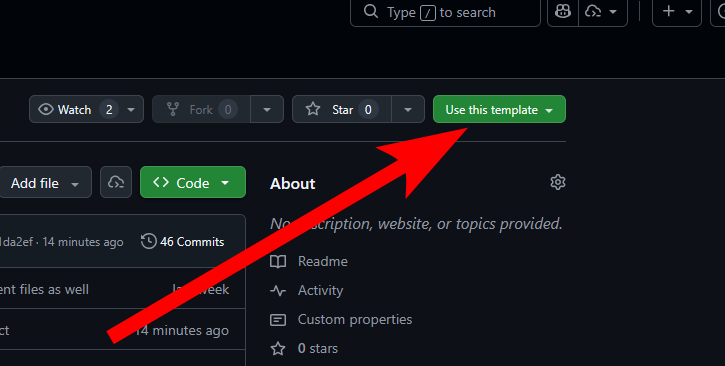
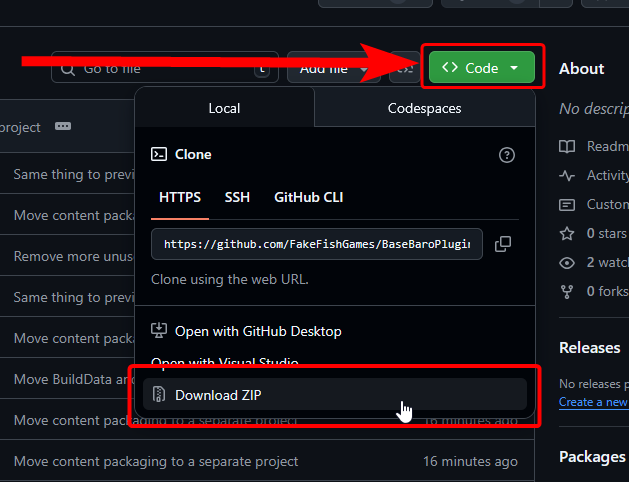
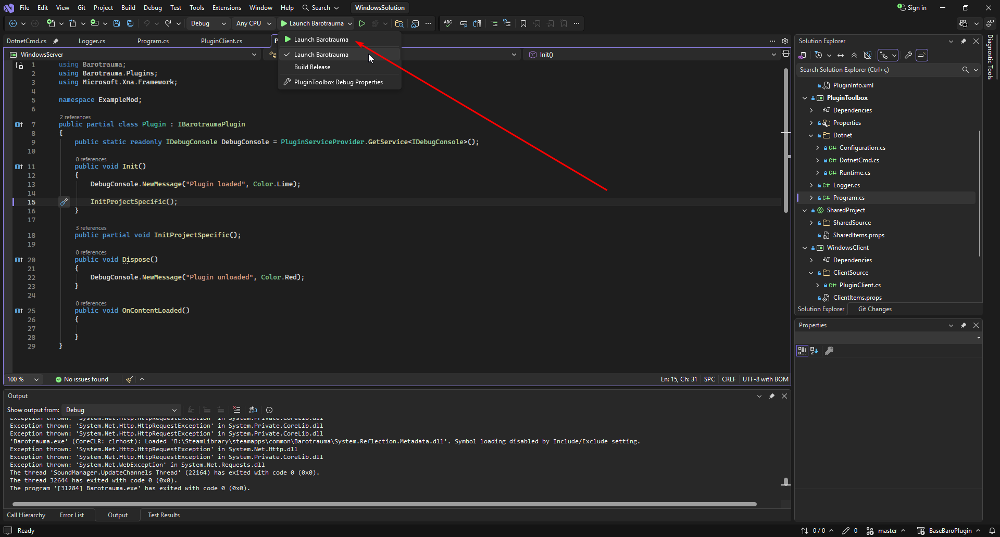
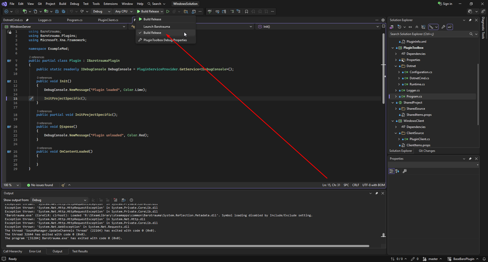

# Getting started with plugins

This page explains how to set up a plugin project using the [Base Barotrauma Plugin](https://github.com/FakeFishGames/BaseBaroPlugin) template, which is the starting point used by most Barotrauma plugins.

## Requirements

Before getting started, make sure you have an IDE that supports **.NET 8**:

- **Visual Studio 2022 or later** (with C# 10 support): https://www.visualstudio.com/vs/community/
- **JetBrains Rider**: https://www.jetbrains.com/rider/

It is also recommended to have **Git** installed:

- **Windows**: download from https://git-scm.com/install/windows
- **Linux**: install Git using your distribution's package manager

## Getting the project

There are two ways to obtain the project.

### Option 1: Use the GitHub template (recommended)



1. Create or sign in to a GitHub account.
2. Click the **Use this template** button in the top-right corner of the [BaseBaroPlugin repository](https://github.com/FakeFishGames/BaseBaroPlugin).
3. Clone your newly created repository locally:
   ```bash
   git clone https://github.com/your_username/your_repo_name
   ```

### Option 2: Download directly



You can also download the repository as a ZIP file from GitHub and extract it locally. This option does not include version control.

## Setting up the project

Before opening the project, a few configuration steps are required. `.props` files can be edited using any text editor.

- Edit the file `BuildData.props` and replace `BaseMod` with your actual mod name.
- Find the file `UserBuildData.props.example` and create a copy named `UserBuildData.props`.
  - Edit `UserBuildData.props`.
  - Update the `ModDeployDir` value so it points to the **LocalMods** directory of your Barotrauma installation.

## Opening the project

You can now open the solution file `WindowsSolution.sln` (or the appropriate solution for your platform: `LinuxSolution.sln` or `MacSolution.sln`).

If the `.sln` file does not open, make sure you have a compatible .NET IDE installed.

Once the solution is open, start by editing `Plugin.cs`, located in the **SharedProject** in the solution explorer. You may also rename the existing `ExampleMod` namespaces in the code to whatever fits your mod.

## Project structure

- **Server-side code**: `ServerProject/ServerSource`
- **Client-side code**: `ClientProject/ClientSource`
- **Shared code** (used by both client and server): `SharedProject/SharedSource`

Within the **SharedProject**, you can use the `CLIENT` and `SERVER` preprocessor symbols to conditionally compile code for the client or the server as needed:

```cs
#if SERVER
DebugConsole.NewMessage("Hello from server");
#endif

#if CLIENT
DebugConsole.NewMessage("Hello from client");
#endif
```

### Content

All mod content (XML files, sounds, textures, etc.) should be placed in `ContentPackageBuilder/Content`.

All files you put here are automatically copied to your `ModDeployDir`. You can trigger this manually by right-clicking the **ContentPackageBuilder** project and selecting **Build**.

If you add new XML content, make sure to update the file list located at `ContentPackageBuilder/filelist.xml`. See [content packages](../Intro/ContentPackages.md) for more information about the file list.

## Testing your mod



You can test your mod by pressing the **Launch Barotrauma** button in the toolbar. This launches Barotrauma with the debugger attached and your plugin built.

Building the plugin also automatically generates the mod in the `LocalMods` folder you configured earlier. You can then enable the mod in-game.

You can also manually right-click **WindowsClient** and **WindowsServer** in the solution view and select **Build**. This does the same as above, without launching Barotrauma.

> **Warning:** this method builds the mod in the **Debug** configuration. To properly publish or update your mod, follow the steps below.

## Building for release

Change the launch option from **Launch Barotrauma** to **Build Release**:



Now click **Build Release** and the plugin will be built in release mode.

## Hot reload

.NET supports Hot Reload, which lets you apply certain code changes while Barotrauma is running, without rebuilding the mod or restarting the game. This is useful for quickly iterating on gameplay logic.

To use Hot Reload in Visual Studio, launch Barotrauma with your plugin enabled. If your IDE is not attached to the Barotrauma process, you can attach the debugger to the running `Barotrauma.exe` process using **Debug → Attach to Process**.

Once attached, make changes to your C# code and apply them using **Hot Reload** (toolbar button) or **Alt + F10**. If the change is supported, it will be applied immediately and you can test it in-game.

Hot Reload works best for changes inside existing methods. Structural changes such as adding new classes, changing method signatures, or modifying fields usually require reloading the entire mod.
